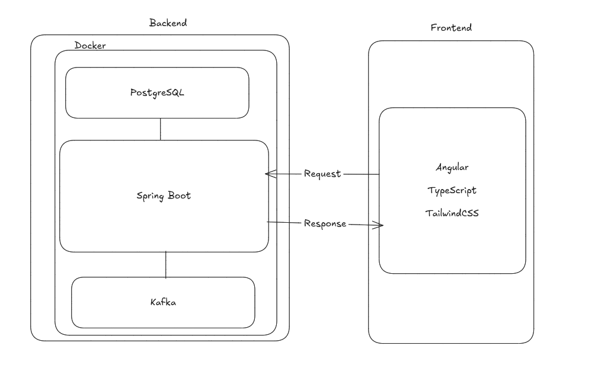
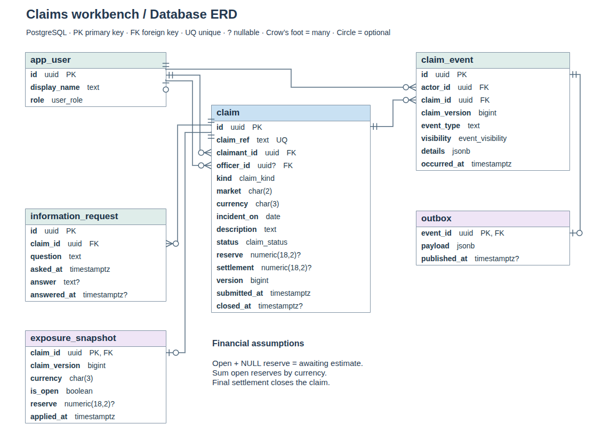
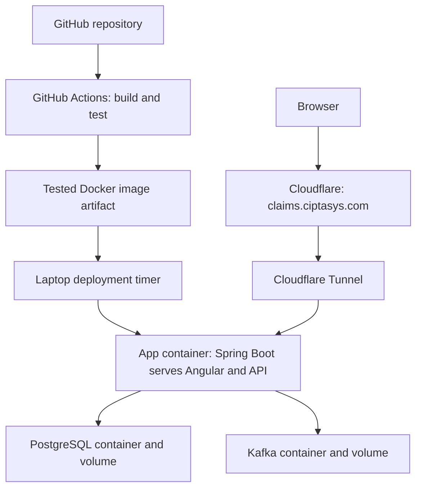

# Claims workbench

A claims demo for reporting incidents, managing assessments and tracking outstanding exposure.

[Try the app](#1-try-the-app) · [How I used AI](#2-how-i-used-ai) · [Timeline](#3-development-and-deployment-timeline) · [Architecture](#4-architecture)

## 1. Try the app

Visit **[claims.ciptasys.com](https://claims.ciptasys.com)**. I host this demo locally on my laptop and expose it through a Cloudflare Tunnel connected to my domain. It is available while my laptop, Docker and tunnel are running.

| Users | Role | Password |
|---|---|---|
| `aina`, `daniel` | Claimant | `local-demo-only` |
| `farah`, `arjun` | Officer | `local-demo-only` |

**Quick walkthrough — use fictional data:**

1. Sign in as **Aina** and submit a claim.
2. Sign in as **Farah**, pick up the claim and request more information.
3. Return as **Aina** to answer the question.
4. As **Farah**, assess the claim, record a reserve and settle or reject it.
5. Return as **Aina** to see the decision.

### Prerequisites

- Git, Docker and Docker Compose, with Docker running.
- Port `18080` available.
- For tests outside Docker: Java 21, Node.js 24/npm and Python 3. The Maven wrapper is included.

### Run locally

```sh
git clone https://github.com/goodbyeO0/claims-workbench.git
cd claims-workbench
API_PORT=18080 docker compose -p claims-review up --build -d
```

Check that the app is ready:

```sh
curl --retry 60 --retry-all-errors --retry-delay 2 --retry-max-time 180 --max-time 5 -fsS http://localhost:18080/actuator/health
```

If you already have the source, run the Compose startup and health-check commands from the folder containing `compose.yaml` (`readme_main_impl/` in my original workspace). The first build can take several minutes. No `.env` is required for a fresh local checkout; Compose provides demo defaults.

Open **[localhost:18080](http://localhost:18080)** and use the accounts above. The health check should return `{"status":"UP"}`. On Linux Docker Desktop, select the `desktop-linux` Docker context if needed.

To stop the app while keeping its data:

```sh
docker compose -p claims-review down
```

Database and Kafka data persist in Docker volumes. Do not add `-v` if you want to keep them. An app restart requires signing in again.

### Run tests

Run from the repository root, with Docker available.

**Contract, backend and fixture UI checks:**

```sh
python3 -m venv .venv
.venv/bin/pip install -r verification/requirements.txt
.venv/bin/python verification/check_contract.py
(cd backend && ./mvnw test)
(cd frontend && npm ci && npx playwright install chromium)
(cd frontend && npm run build && npm run test:fixture)
```

**Integration checks:** start the local app first. These checks create demo claims.

```sh
.venv/bin/python verification/api_smoke.py --base http://localhost:18080 --through decision
.venv/bin/python verification/backend_gate.py --base http://localhost:18080
(cd frontend && E2E_BASE_URL=http://localhost:18080 npm run test:e2e)
```

See the [test cases and acceptance criteria](docs/06-test-cases.md) and [integration walkthrough](docs/05-integration.md). Actual test results are recorded in [AI-JOURNAL.md](AI-JOURNAL.md).

## 2. How I used AI

I used **ChatGPT Web for planning** and **Codex for implementation and testing**.

### Understand and plan

| Step | What I did |
|---|---|
| Understand the task | I researched the assessment in ChatGPT Web and asked it to explain the requirements. |
| Explore the workflows | I discussed the main flow, alternative flows, invalid actions and flows that must never happen until I understood how this simplified insurance claims process works. |
| Model the database | I asked it to generate a database ERD using draw.io, shown in the architecture section below. |
| Connect flows to data | I walked through how each action changes the data and questioned fields that seemed unnecessary. |
| Choose the stack | I asked for recommendations and challenged some choices. It initially suggested .NET, but I chose Spring Boot because I was more familiar with it. |
| Check technology versions | I asked it to verify versions against its knowledge cutoff, current documentation and security information, rather than rely only on memory. Version and advisory checks reduce avoidable errors but do not replace a complete dependency security review. |
| Keep the approach simple | I asked for a straightforward implementation, an OpenAPI specification and a README describing the build plan. The API specification became the source of truth. |

### Build and verify

| Step | What I did |
|---|---|
| Plan three stages | I divided delivery into backend, frontend and integration, with each stage split into smaller features. |
| Test and fix each feature | For every feature, Codex ran the relevant checks against the [test guide and expected results](docs/06-test-cases.md), [OpenAPI contract](api/openapi.yaml) and stage requirements. If a check failed, Codex investigated, corrected the implementation and reran the checks until they passed before moving to the next feature. Failures, fixes and actual results were recorded in the [AI journal](AI-JOURNAL.md). |
| Verify the complete stage | After the individual features passed, Codex ran the complete stage checks before moving from backend to frontend, then integration. Passing one feature was not enough to consider the whole stage complete. |
| Build the backend | Codex implemented and tested the backend features first, preserving the supplied database migration. |
| Build the frontend | Codex first built the UI using placeholder (fixture) data, without connecting to the real backend. It used Playwright browser tests to verify the user journeys, interactions and error states. Only after these checks passed did it connect the frontend to the real API in the integration stage. |
| Integrate | Once both stages passed, Codex connected the UI to the real API and tested the complete journeys. A shared request/response contract also makes independent backend and frontend work possible, although I chose to build them sequentially here. |

### Review and deliver

| Step | What I did |
|---|---|
| Review and record | I asked Codex to review diffs, record actual tests and decisions in the journal, and commit meaningful changes. I paused when Codex reached its usage limit and resumed after it reset. |
| Host the demo | With extra time, I hosted it on my laptop through Cloudflare and my domain, then added GitHub Actions and automatic deployment. |

Planning guides: [workflow and data](docs/01-contract-and-data.md), [backend](docs/02-backend.md), [reporting](docs/03-reporting.md), [frontend](docs/04-frontend.md) and [OpenAPI contract](api/openapi.yaml).

## 3. Development and deployment timeline

All times below are **Malaysia time (UTC+8), November 2026**. Active time is approximate Codex working time, including tests and tools within a session; it excludes inactive gaps and most explanation-only conversations.

| Date | Work period | Active time | What happened | Git commits |
|---|---|---|---|---|
| 21 Nov | 03:57–04:17 | ~20 min | Backend foundation, login, claim workflows, reserves and settlement. | `9c1f706` → `6c8611e` |
| 21 Nov | 13:45–14:01 | ~15 min | Finished backend reporting, Kafka and tests; paused because my Codex limit was close. | `5f5f3f4`, `f071372` |
| 21 Nov | 18:46–19:10 | ~20 min | Built the frontend and integrated the API; paused near the Codex limit. | `7010051`, `cff339c` |
| 22 Nov | 00:12–00:19 | ~7 min | After the reset, completed final verification and submission documentation. | `343e648`, `2fffea2` |
| 22 Nov | 00:35–01:04 | ~18 min | Configured Cloudflare hosting, the public repository, CI, private settings and laptop startup. | `504831d`, `c203344`, `b132697`, `2595dca` |
| 22 Nov | 01:16–01:22 | ~6 min | Fixed login highlighting, tested, pushed and verified the deployed app. | `10f905b`, `8bed6d3` |
| 22 Nov | 01:35–01:39 | ~4 min | Added automatic deployment of tested GitHub Actions images to local Docker. | `f645d5f` |
| 22 Nov | 12:49–12:50 | ~1 min | Verified automatic deployment and preservation of existing data. | `67068f3` |

### Time summary

| Activity | Approximate time |
|---|---|
| Planning in ChatGPT Web | 40 minutes |
| Recorded Codex development and verification | 63 minutes (1 hour 3 minutes) |
| Recorded hosting, deployment and UI fix | 29 minutes |
| Planning + all recorded work above | **132 minutes (2 hours 12 minutes)** |

I paused when Codex reached its usage limit and resumed after it reset. Time spent waiting for the reset is excluded from the active time above.

For the complete Codex journal, including failures, retries and decisions, see **[AI-JOURNAL.md](AI-JOURNAL.md)**. Use **Ctrl+F and search for `Izhan`** to find my input and decisions.

## 4. Architecture

### Technology stack



| Technology | Why it is used / what to know |
|---|---|
| Angular 21 | The assessment prefers Angular for both user roles. Although my frontend experience is mainly React, I followed that requirement. Angular runs in the browser; Spring Boot serves its built files. |
| TypeScript and Tailwind CSS 4 | I already have experience with both from my React work, so I could reuse that familiarity for typed frontend code and styling. |
| Spring Boot 4.0 and Java 21 | I chose Spring Boot because I have used it before. Its HTTP handling, dependency injection and class-based structure help me organize controllers, services and data access in a maintainable way. This demo has not been load-tested for peak traffic. |
| One backend application | I kept the early-stage system simple rather than introducing microservices and separate deployments. The API, Kafka publisher and consumer run in one Spring Boot process. |
| Spring Security sessions | Cookie sessions, role checks and CSRF protection provide straightforward authentication for the same-origin app without building a custom token system. Demo identities are local; production identity provisioning is outside this assessment. |
| REST/HTTP | User actions need an immediate success or error response. The OpenAPI contract defines the requests and responses shared by frontend and backend. |
| PostgreSQL 17 and Flyway | Transactions keep claim changes, audit events and outbox records together. Flyway manages the schema; the original migration is preserved. |
| Kafka 4.2 | I wanted reliable financial reporting updates and a good fit with Spring Boot. Kafka supports retries and replay without making claim requests wait for report processing. It can redeliver messages, so the consumer applies only newer claim versions to prevent duplicate or older events from changing totals again. |
| Docker Compose | Packages the app and its dependencies into a repeatable setup so reviewers can run it on their own machines without installing Java, PostgreSQL or Kafka separately. |
| JUnit, Testcontainers and Playwright | Backend checks with real infrastructure and browser tests for fixture and integrated flows. |

The stack diagram groups three separate containers under Docker: the app, PostgreSQL and Kafka. The frontend box represents code running in the browser.

The established Spring ecosystem supports ongoing maintenance and integration. Dependency maintenance and security updates remain necessary. References: [Spring Boot](https://spring.io/projects/spring-boot/) and [Spring for Apache Kafka](https://spring.io/projects/spring-kafka/).

**Reporting reliability:** the transactional outbox and version-checked consumer make retries safe for the exposure projection, including when Kafka redelivers a message. Reports can briefly lag behind claim changes because processing is asynchronous.

### Database



[Open the draw.io ERD file on Google Drive](https://drive.google.com/file/d/1L9-8Wz5qd1a1JzFhSSGiU2jLttPXqeWC/view?usp=sharing).

The database links users to claims, information requests and audit events. Financial changes save an outbox record in the same transaction as the claim; Kafka processing then updates the exposure snapshot. Claim versions prevent stale updates and older reporting events from overwriting newer data.

Outstanding exposure is the total reserve for open claims, grouped by currency. An open claim without a reserve is counted as awaiting an estimate. Settlement closes the claim and removes its reserve from outstanding exposure. The [SQL migration](backend/src/main/resources/db/migration/V1__claims.sql) defines the actual schema.

### Deployment



**From a code change to a running app:**

1. A push to `master` triggers GitHub Actions.
2. CI tests the backend, builds and tests the frontend, then tests the packaged app.
3. A successful run exports the tested Docker image as an artifact.
4. The laptop's deployment timer checks every minute and deploys the image, usually within one to two minutes plus download and startup time.
5. The app container is replaced while PostgreSQL and Kafka data volumes are kept. If the startup health check fails, the previous image is restored.

Host configuration changes still require a separate local update.

**How visitors reach the app:**

Visitors reach Cloudflare over HTTPS. The tunnel forwards requests to `localhost:18080` on my laptop, where Spring Boot serves both the frontend files and API. **Nginx is not used.** Startup is configured at laptop sign-in; the site is unavailable while the laptop is off or asleep.

Private `.env` settings and Cloudflare credentials stay outside Git. See [hosting and CI details](docs/HOSTING-AND-CI.md) for configuration and deployment controls.

### Scope and limitations

This demo covers claim submission, assessment, decisions and reporting. Policy checks, actual payments, document uploads and notifications are outside this assessment. See [operations and limitations](docs/OPERATIONS.md) for technical details.
